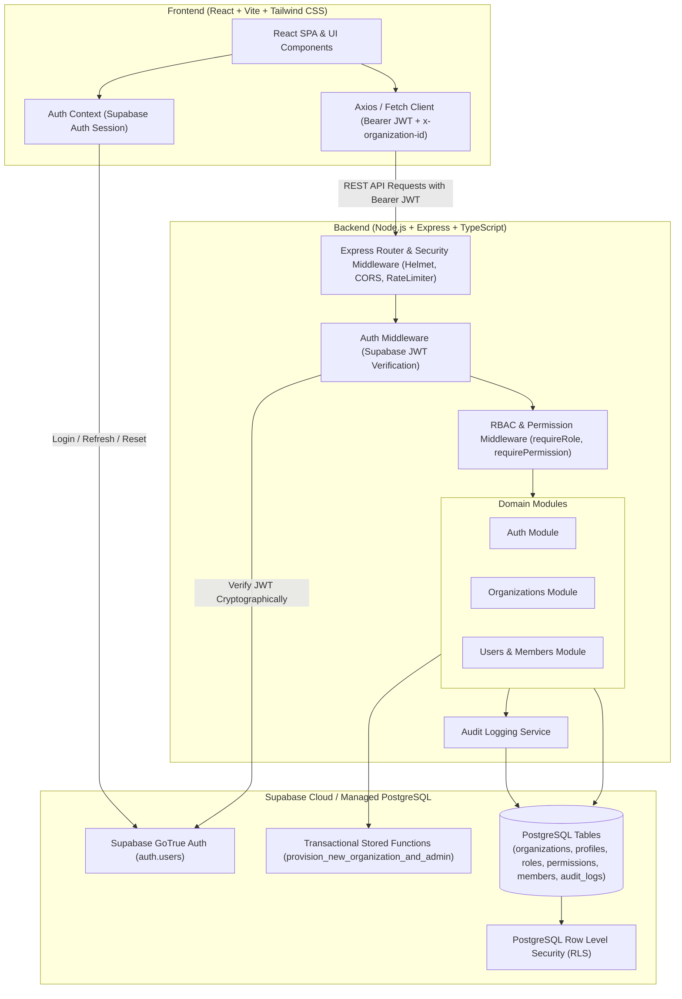
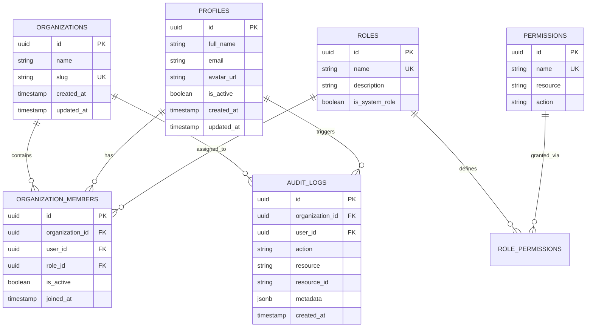

# Modern CRM Platform — Architecture Documentation

## 1. System Overview

The Modern CRM Platform is engineered as a clean, production-grade SaaS application designed to deliver an agile, responsive customer relationship management platform. The initial foundation and Module 01 establish:
- Secure multi-tenant organization workspaces
- Supabase Auth cryptographic JWT authentication
- Granular Role-Based Access Control (RBAC) with database-enforced policies
- Centralized user profile and organization membership lifecycle management
- Audit logging for administrative events

The platform deliberately avoids bloated architectures (such as asynchronous queue dependencies like Redis/Kafka or separate microservices) in favor of a robust, high-performance **modular monolith** with clear boundary isolation between frontend client, backend Node.js API, and Supabase PostgreSQL.

---

## 2. High-Level Architecture Diagram

---

## 3. Core Architectural Principles

1. **Separation of Concerns**: The frontend never communicates with the database directly using privileged keys. The service-role key is kept exclusively on the Node.js backend.
2. **Identity vs Business Logic**: Supabase Auth manages password hashing, session tokens, refresh cycles, and identity claims. The Node.js backend validates tokens and enforces domain business rules.
3. **Multi-Tenant Workspace Isolation**: Every tenant belongs to an `organizations` row. Every user is linked through `organization_members`. Queries in subsequent CRM modules are scoped strictly by `organization_id`.
4. **Defense-in-Depth**:
   - Level 1: HTTP Security Headers (Helmet), CORS restriction, Rate Limiting.
   - Level 2: Backend middleware authentication (`requireAuth`) and authorization (`requireRole`, `requirePermission`).
   - Level 3: Database-level Row-Level Security (RLS) and foreign key constraints.
5. **Atomic Provisioning**: New organization signup is executed via a PostgreSQL `SECURITY DEFINER` function (`provision_new_organization_and_admin`) guaranteeing that user profiles, workspace records, and Admin role assignments succeed as an atomic transaction.

---

## 4. Multi-Tenant Organization Model

---

## 5. Role-Based Access Control (RBAC) Specification

| Role | Scope | Key Capabilities | Prohibitions |
| :--- | :--- | :--- | :--- |
| **ADMIN** | Organization Wide | Full control over organization settings, member management, role assignment, status toggling, and all future CRM resources. | Cannot modify their own role or deactivate the organization's sole active Admin. |
| **MANAGER** | Team / Org Scope | Read organization and team members; full management of assigned CRM records. | Cannot modify organization settings, invite admins, or alter roles. |
| **SALES_REP**| Assigned Scope | Create, update, and manage assigned CRM records (leads, accounts, contacts, deals). | Cannot alter team membership or modify other users' roles. |
| **VIEWER** | Read-Only | Read-only access across authorized CRM records. | Cannot create, update, or delete records. |

---

## 6. Request Lifecycle & Authorization Flow

1. **Client Request**: Frontend issues an HTTP request to `http://localhost:5000/api/v1/...` including:
   - Header: `Authorization: Bearer <supabase_access_token>`
   - Optional Header: `x-organization-id: <uuid>` (for multi-workspace users)
2. **CORS & Rate Limiter**: Express evaluates origin and request rate limits.
3. **Authentication Middleware (`requireAuth`)**:
   - Calls `supabaseAdmin.auth.getUser(token)` to verify the cryptographically signed JWT.
   - Verifies the user is active in `profiles`.
   - Resolves active organization membership from `organization_members`.
   - Resolves associated role and granted permissions.
   - Populates `req.userContext`.
4. **RBAC Middleware (`requireRole`, `requirePermission`)**:
   - Asserts that `req.userContext.role` or `req.userContext.permissions` contains the required privilege.
5. **Business Logic Execution**: Controller calls domain Service layer with validated input.
6. **Audit Trail**: Sensitive actions trigger non-blocking, reliable entries in `audit_logs`.
7. **Response Envelope**: Standard envelope emitted:
   - Success: `{ "success": true, "message": "...", "data": {...} }`
   - Error: `{ "success": false, "message": "...", "error": { "code": "...", "details": ... } }`
