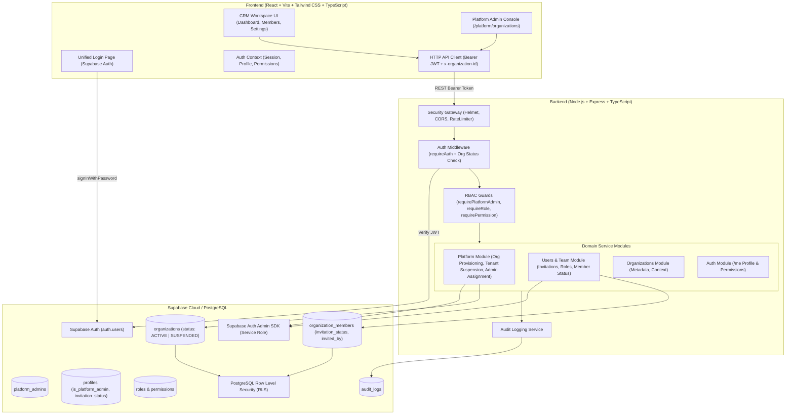
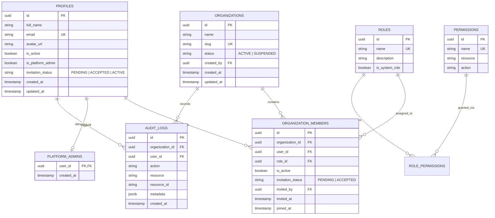

# Nexora CRM — Architecture Documentation

## 1. System Overview

Nexora is engineered as an enterprise-grade SaaS Customer Relationship Management (CRM) platform following a **Salesforce-style organization-controlled access model**.

Key architectural pillars for Foundation and Module 01 include:
- **Strict Organization-Controlled Provisioning**: Self-service public user registration and arbitrary organization creation are completely decommissioned.
- **Two Distinct Administrative Tiers**:
  1. **Platform Administrator**: Internal Nexora administrator who provisions customer organizations, manages tenant lifecycle states (`ACTIVE` vs `SUSPENDED`), and assigns initial Organization Admins.
  2. **Organization Administrator**: Customer-level administrator who manages team members, invites users via email, assigns granular organizational roles, and governs member access states.
- **Unified Authentication Gateway**: All users (Platform Admins, Org Admins, and Organization Members) authenticate through a single, unified Nexora login portal powered by Supabase GoTrue Auth.
- **Active Membership Enforcement**: A valid Supabase JWT token alone does not grant CRM access. Users must have an active membership in an active organization (or verified Platform Admin status) to access application APIs.
- **Multi-Tenant Isolation**: Tenant data is isolated cryptographically and logically at the application middleware and PostgreSQL Row-Level Security (RLS) layers.
- **Modular Monolith**: High cohesion, zero microservice bloat, no external message queue dependencies (no Redis, Kafka, or BullMQ required for core functionality).

---

## 2. High-Level Architecture Diagram

---

## 3. Administrative Tiers & Role Specification

### A. Platform Administrator (Internal Nexora Admin)
- **Scope**: Platform-wide.
- **Responsibilities**:
  - Provision new customer tenant organizations.
  - Update organization names and vanity URL slugs.
  - Activate or suspend tenant organizations (`status: ACTIVE | SUSPENDED`). When suspended, all members of that tenant are blocked from CRM APIs.
  - Assign or reassign the primary Organization Administrator.
  - Manage platform configurations.
- **Security & Bootstrap**:
  - Maintained in a dedicated `platform_admins` database table.
  - Privileges can **never** be obtained via public endpoints or organization role assignments.
  - Initial platform administrator is provisioned exclusively via secure CLI bootstrap: `npm run bootstrap:admin -- <email> [fullName] [password]`.

### B. Organization Administrator (Tenant Admin)
- **Scope**: Specific customer organization only.
- **Responsibilities**:
  - Invite new team members by email (`email`, `fullName`, `role`).
  - Resend pending email invitations.
  - Promote or change user roles (`MANAGER`, `SALES_REP`, `VIEWER`).
  - Activate / Deactivate members within their organization.
- **Prohibitions**:
  - Cannot access other tenant organizations.
  - Cannot assign Platform Admin rights.
  - Cannot modify their own role or deactivate the organization's sole active Admin.

### C. Organization Members
- **MANAGER**: Team supervisor with elevated visibility into assigned records.
- **SALES_REP**: Operational CRM user managing assigned leads, accounts, contacts, and deals.
- **VIEWER**: Read-only auditor or stakeholder.

---

## 4. Multi-Tenant Relational Schema

---

## 5. Security & Request Lifecycle

1. **Authentication Verification**:
   - `requireAuth` validates the Supabase JWT using `supabaseAdmin.auth.getUser(token)`.
   - Checks if user exists and is active in `profiles`.
   - Checks if user is recorded in `platform_admins`.
   - Resolves organization membership from `organization_members`.
   - **Suspension Gate**: If the user's organization is `SUSPENDED`, requests are immediately rejected with `403 FORBIDDEN_ORGANIZATION_SUSPENDED`.
   - Populates typed `req.user` context.
2. **Platform Admin Gate (`requirePlatformAdmin`)**:
   - Asserts `req.user.isPlatformAdmin === true`. Rejects with `403 FORBIDDEN_PLATFORM_ADMIN` otherwise.
3. **Role & Permission Guards (`requireRole`, `requirePermission`)**:
   - Asserts that the authenticated member possesses the necessary role or granular permission within the organization.
4. **Audit Trail**:
   - Administrative mutations (organization provisioning, status changes, invitations, role changes) log an immutable entry in `audit_logs`.
5. **Standardized JSON Envelope**:
   - Success: `{ "success": true, "message": "...", "data": {...} }`
   - Error: `{ "success": false, "message": "...", "error": { "code": "...", "details": ... } }`
